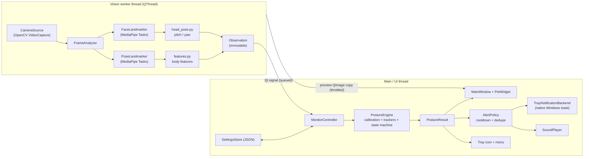
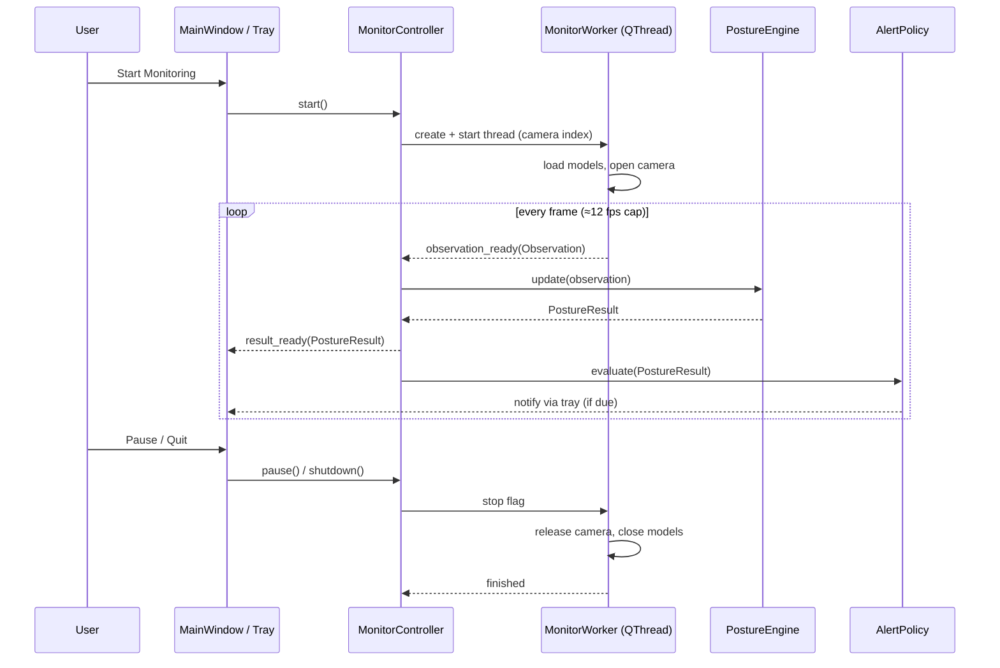
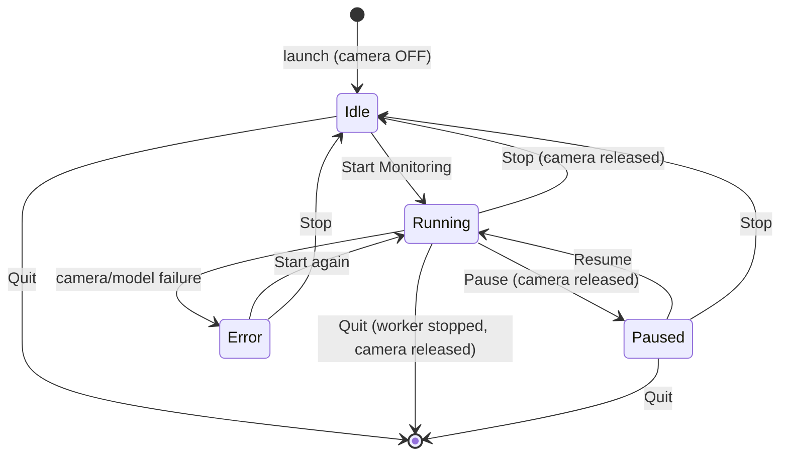
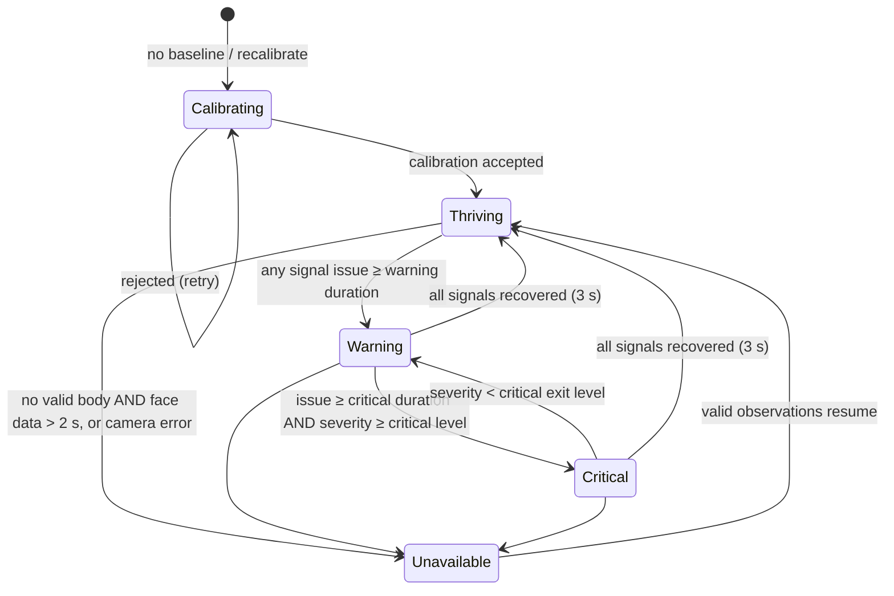

# Pixel Posture

> **Your posture. Your pixel pal. Your gentle reminder.**

Pixel Posture is a privacy-conscious, webcam-based posture companion for Windows. It watches one person sitting in front of a laptop, works out when they have been slouching or bending their head down for a while, and gently reminds them to reset. **Pip**, a small pixel-art pet, reacts to the current posture state.

Start monitoring, minimize the window, and keep working in VS Code, Chrome or Word. Pixel Posture keeps running in the system tray and sends native Windows notifications when a posture issue lasts long enough to matter.

The repository contains two independent deliverables:

| Deliverable | Folder | What it is |
|---|---|---|
| **Desktop app** (the product) | [`local-app/`](local-app/) | Python + PySide6 tray utility. Real webcam capture and real MediaPipe landmark inference, all on your own computer. |
| **Showcase website** | [`showcase/`](showcase/) | React + Vite + TypeScript site that explains the project. Its demo is **simulated**. It never turns on your camera and does no posture detection. |

> **Not a medical device.** Pixel Posture is a posture-awareness aid. It does not diagnose anything, does not measure anatomical angles with clinical accuracy, and cannot guarantee that it will prevent injury. Its thresholds are experimental defaults, not clinically validated values.

---

## Table of contents

1. [Problem and motivation](#1-problem-and-motivation)
2. [Objectives](#2-objectives)
3. [Features and non-goals](#3-features-and-non-goals)
4. [Desktop app vs. showcase website](#4-desktop-app-vs-showcase-website)
5. [Architecture and data flow](#5-architecture-and-data-flow)
6. [Technology stack](#6-technology-stack)
7. [Folder structure](#7-folder-structure)
8. [Desktop lifecycle (tray, minimize, close, pause, quit)](#8-desktop-lifecycle)
9. [Webcam processing and privacy model](#9-webcam-processing-and-privacy-model)
10. [Posture detection methodology](#10-posture-detection-methodology)
11. [Calibration](#11-calibration)
12. [Temporal filtering, states and notifications](#12-temporal-filtering-states-and-notifications)
13. [Installation](#13-installation)
14. [Running the desktop app](#14-running-the-desktop-app)
15. [Running the website locally](#15-running-the-website-locally)
16. [Testing, linting, type checking and builds](#16-testing-linting-type-checking-and-builds)
17. [Deploying the website](#17-deploying-the-website)
18. [GitHub repository setup](#18-github-repository-setup)
19. [Configuration](#19-configuration)
20. [Desktop packaging (experimental)](#20-desktop-packaging-experimental)
21. [Troubleshooting](#21-troubleshooting)
22. [Known limitations](#22-known-limitations)
23. [Privacy and security](#23-privacy-and-security)
24. [Roadmap and acceptance criteria](#24-roadmap-and-acceptance-criteria)
25. [Verification status](#25-verification-status)
26. [License and third-party assets](#26-license-and-third-party-assets)

---

## 1. Problem and motivation

Students and knowledge workers spend hours at laptops. Laptop screens sit low, so people tend to drop their head, round their shoulders and sink into the chair, usually without noticing until their neck or back starts to hurt. Posture apps are often intrusive (always-on cloud video), nagging (alerting on every small movement), or easy to ignore.

Pixel Posture aims to be:

- **Local.** Video frames never leave the computer.
- **Personal.** It compares you with *your own* calibrated neutral position, not a universal "correct" angle.
- **Patient.** It ignores brief movements and only reminds you about deviations that *last*.
- **Pleasant.** It gives feedback through a friendly pixel pet and gentle, non-shaming language.

## 2. Objectives

- Continuously monitor posture while monitoring is enabled, including while the window is hidden.
- Estimate **back/shoulder slouching** and **downward head tilt** as two separate signals.
- Calibrate both signals to the user's initial comfortable position.
- Ignore brief, ordinary movement. Escalate based on both how long a deviation lasts and how large it is.
- Present an attractive, responsive desktop UI with an animated pixel pet.
- Keep running from the system tray and deliver native Windows notifications.
- Process webcam frames only in memory, on the local machine.
- Provide a separately deployable React showcase website.
- Ship documentation, automated tests and deployment instructions.

## 3. Features and non-goals

### Features (desktop app)

- Explicit, user-initiated camera start (the camera is **never** turned on at launch), with a camera selector.
- MediaPipe **Pose Landmarker** (body) and **Face Landmarker** (head pose) inference on a background thread.
- Two independent posture signals, each with a calibrated baseline, a tolerance, a severity score, an issue timer and a recovery condition.
- Robust calibration: many frames, median baseline, stability check, and rejection if the face or shoulders cannot be detected.
- Time-based smoothing (frame-rate independent), hysteresis and recovery confirmation.
- Pet state machine: **Calibrating → Thriving → Warning → Critical**, plus **Tracking unavailable**.
- In-app reminders, native Windows notifications (through the tray icon), an optional system sound, and cooldown/duplicate suppression.
- System tray with Open, Start/Pause/Resume, Settings and Quit. Closing the window minimizes to the tray by default; this can be configured.
- Single-instance guard. Launching a second copy brings up the existing window instead.
- Live preview (optional, can be turned off) with an optional landmark overlay.
- Session summary: monitored time, share of time within your usual range, and reminders sent.
- Persistent settings stored as validated JSON in the user's app-data folder.

### Non-goals

- Medical diagnosis or clinical measurement.
- Multi-person tracking.
- Cloud processing, accounts, analytics or telemetry.
- Recording or saving video or images.
- Custom ML model training.
- macOS/Linux support. The code is mostly portable, but only Windows is targeted and documented.
- Launch-at-login (not implemented; if it is ever added, it will be opt-in).

## 4. Desktop app vs. showcase website

| | Desktop app (`local-app/`) | Showcase website (`showcase/`) |
|---|---|---|
| Purpose | The actual posture monitor | Explains and presents the project |
| Camera | Uses your webcam after you press **Start** | **Never** requests camera access |
| Posture detection | Real MediaPipe inference + posture engine | **None**. The demo plays scripted, clearly labelled example states |
| Notifications | Native Windows notifications via the tray | None |
| Runs where | Your Windows PC | Any static host (Vercel / Netlify) |
| Depends on the other? | No | No |

The website's demo shows the banner **"Simulated Demo — no live posture detection"** wherever simulated values appear.

## 5. Architecture and data flow



**Threading model**

- Exactly one `MonitorWorker` runs at a time and owns the camera. It runs on a dedicated `QThread` and does the slow work: capture, colour conversion and the two MediaPipe models.
- The worker emits **immutable** `Observation` dataclasses and **copied** preview `QImage`s through queued Qt signals. Frame buffers are never shared between threads.
- The `PostureEngine` (pure Python, microseconds per update), the `AlertPolicy` and all UI run on the main thread. Notifications therefore never block the vision worker, and posture logic needs no locks.
- The worker only reads a thread-safe stop flag (`threading.Event`) and a preview on/off flag.



Module responsibilities (each one is testable without the UI or a webcam unless noted):

| # | Responsibility | Module |
|---|---|---|
| 1 | Webcam capture and enumeration | `app/vision/camera.py` |
| 2 | Body landmark extraction | `app/vision/landmarks.py` |
| 3 | Head-pose estimation | `app/vision/head_pose.py` |
| 4 | Posture feature calculation (pure geometry) | `app/posture/features.py` |
| 5 | Calibration | `app/posture/calibration.py` |
| 6 | Temporal filtering and state transitions | `app/posture/signal_tracker.py`, `app/posture/engine.py` |
| 7 | Alert scheduling and cooldowns | `app/services/alerts.py` |
| 8 | Notification delivery and sound | `app/services/notifications.py` |
| 9 | Desktop UI and pet rendering | `app/ui/` |
| 10 | Persistent settings | `app/settings/store.py` |
| 11 | Website | `showcase/` |
| 12 | Tests and documentation | `local-app/tests/`, `showcase/src/**/*.test.tsx`, `docs/` |

More detail is in [`docs/architecture.md`](docs/architecture.md).

## 6. Technology stack

| Choice | Why |
|---|---|
| **Python 3.11** | Supported by every dependency below. Verified locally with 3.11.9. |
| **PySide6-Essentials 6.12** | Official Qt for Python (LGPL). Provides widgets, `QThread`, signals/slots, `QSystemTrayIcon` and `QLocalServer`. The *Essentials* wheel avoids the ~300 MB WebEngine and multimedia add-ons this app does not use. |
| **MediaPipe 1.1 (Tasks API)** | Maintained on-device pose and face models. Version 1.x removed the legacy `mp.solutions` API, so the app uses `PoseLandmarker` and `FaceLandmarker` with downloaded `.task` model bundles. |
| **OpenCV (`opencv-contrib-python`)** | Webcam capture (DirectShow/MSMF on Windows) and frame preparation. The *contrib* build is the one MediaPipe itself depends on; installing plain `opencv-python` as well would create two conflicting `cv2` packages. |
| **NumPy** | Robust statistics (medians, interquartile ranges) and matrix maths for head pose. |
| **Native notifications via `QSystemTrayIcon.showMessage`** | On Windows 10/11 Qt sends these through `Shell_NotifyIcon`, and Windows shows them as native toast notifications attributed to the tray icon. This needs no extra dependency, no AppUserModelID registration and no packaging step, and it respects Windows *Do Not Disturb*. `winotify`/`windows-toasts` were considered, but they need a registered app identity to be reliable for unpackaged Python apps. |
| **`winsound` (stdlib)** | Short asynchronous system sound. No extra dependency. |
| **pytest + pytest-qt** | Unit tests for the posture logic, plus Qt lifecycle tests run on the `offscreen` platform. |
| **Ruff, mypy** | Linting, formatting and static type checking. |
| **React 19 + Vite + TypeScript** | Fast, typed, static website that is easy to host. |
| **react-router-dom** | Small client-side routing for Home / Demo / Docs / About. |
| **oxlint** | The fast linter that ships with the current Vite React template; run with `--deny-warnings`. |
| **lucide-react** | One consistent, MIT-licensed icon set. |
| **@fontsource (Inter, Press Start 2P)** | Self-hosted fonts, so the site makes **no third-party font requests**. |
| **Vitest + Testing Library** | Lightweight website tests that reuse the Vite config. |
| **Vercel or Netlify** | Static hosting. Configuration for both is included. |

## 7. Folder structure

```
Pixel_Posture/
├── README.md                     ← this file (source of truth)
├── LICENSE                       ← MIT
├── THIRD_PARTY_NOTICES.md        ← licenses of redistributed components
├── .gitignore
├── pyproject.toml                ← Ruff / mypy / pytest configuration
├── requirements.txt              ← pinned runtime dependencies (desktop app)
├── requirements-dev.txt          ← runtime + test/lint/type-check tools
├── .github/workflows/ci.yml      ← Python tests + website build in CI
├── docs/
│   ├── architecture.md
│   ├── privacy.md
│   └── testing.md
├── local-app/
│   ├── main.py                   ← desktop entry point
│   ├── scripts/
│   │   ├── download_models.py    ← fetches + SHA-256-verifies MediaPipe models
│   │   └── export_sprites.py     ← exports Pip's sprites as SVG for the website
│   ├── packaging/
│   │   └── pixel_posture.spec    ← experimental PyInstaller spec
│   ├── app/
│   │   ├── __init__.py
│   │   ├── application.py        ← wires controller, window, tray, settings, notifications
│   │   ├── logging_setup.py
│   │   ├── posture/              ← pure logic: no Qt, no OpenCV, no MediaPipe
│   │   │   ├── models.py         ← typed dataclasses + enums (Observation, PostureResult, …)
│   │   │   ├── config.py         ← thresholds/tolerances (PostureConfig)
│   │   │   ├── features.py       ← landmarks → body features; matrix → head angles
│   │   │   ├── calibration.py    ← Calibrator → Baseline
│   │   │   ├── signal_tracker.py ← smoothing, hysteresis, timers per signal
│   │   │   └── engine.py         ← PostureEngine + pet state machine
│   │   ├── vision/
│   │   │   ├── camera.py         ← CameraSource, camera enumeration
│   │   │   ├── model_assets.py   ← model paths, hashes, verification
│   │   │   ├── landmarks.py      ← MediaPipe PoseLandmarker wrapper
│   │   │   ├── head_pose.py      ← MediaPipe FaceLandmarker wrapper
│   │   │   └── analyzer.py       ← FrameAnalyzer: frame → Observation
│   │   ├── services/
│   │   │   ├── alerts.py         ← AlertPolicy (cooldowns, dedupe, pause)
│   │   │   ├── notifications.py  ← NotificationBackend + tray backend + sound
│   │   │   ├── worker.py         ← MonitorWorker (QThread worker)
│   │   │   ├── monitor.py        ← MonitorController (lifecycle owner)
│   │   │   ├── session.py        ← session statistics
│   │   │   └── single_instance.py
│   │   ├── settings/
│   │   │   └── store.py          ← AppSettings dataclass + validated JSON store
│   │   ├── ui/
│   │   │   ├── theme.py          ← design tokens + Qt stylesheet
│   │   │   ├── sprites.py        ← pixel-art definitions (single source for app + site)
│   │   │   ├── pet_widget.py
│   │   │   ├── widgets.py        ← cards, chips, signal panels, preview
│   │   │   ├── settings_dialog.py
│   │   │   ├── tray.py
│   │   │   └── main_window.py
│   │   └── resources/
│   │       ├── fonts/            ← Press Start 2P (SIL OFL) + license
│   │       └── models/           ← downloaded .task files (git-ignored) + README with provenance
│   └── tests/                    ← pytest suite for the desktop app
└── showcase/                     ← React + Vite website (independent)
    ├── package.json, package-lock.json
    ├── index.html                ← title, meta description, favicon
    ├── vite.config.ts            ← Vite + Vitest configuration
    ├── vercel.json               ← build settings + SPA rewrites for Vercel
    ├── netlify.toml              ← build settings for Netlify (base directory: showcase)
    ├── .env.example              ← VITE_REPO_URL
    ├── tsconfig*.json            ← app / node / test TypeScript projects
    ├── public/                   ← favicon.svg, _redirects (Netlify SPA fallback), screenshots/, licenses/
    └── src/
        ├── main.tsx, App.tsx, App.test.tsx, config.ts, hooks.ts
        ├── components/           ← header, footer, PetSprite, CodeBlock, RepoLink
        ├── pages/                ← Home, Demo, Docs, About, NotFound
        ├── demo/script.ts        ← scripted (simulated) demo states
        ├── styles/               ← tokens.css (design tokens), global.css
        ├── assets/pet/           ← Pip SVGs exported from sprites.py
        └── test/setup.ts
```

Python tests live in `local-app/tests/`. Website tests sit next to the code under `showcase/src/`. There is no separate root `tests/` folder, to avoid two competing test trees.

The UI's checkbox tick and combo-box chevron are drawn with QPainter at startup into `%APPDATA%\PixelPosture\cache\icons`. The slim `PySide6-Essentials` wheel cannot load SVG, so these small icons are generated rather than committed as binaries.

## 8. Desktop lifecycle



| Action | Behaviour |
|---|---|
| **Launch** | Window opens. Camera stays **off**. A tray icon appears. A second launch focuses the existing instance. |
| **Start Monitoring** | Opens the selected camera on the worker thread. Starts calibration automatically if there is no saved baseline. |
| **Minimize / switch apps** | Monitoring continues. Preview rendering pauses while the window is hidden, to save CPU; inference keeps running. |
| **Close window (X)** | Default: hides to the tray and shows a one-time explanation. If *Close button minimizes to tray* is turned off, a dialog asks whether to **Quit** or **Keep running in tray**. |
| **Pause** | Stops the worker and **releases the camera** (camera light turns off). No posture judgements, no notifications. Your baseline is kept. |
| **Resume** | Restarts the worker with the same baseline. Issue timers start fresh. |
| **Stop** | Ends the session, releases the camera and returns to Idle. |
| **Quit** (tray or dialog) | Stops monitoring, waits for the worker thread to finish (bounded wait), releases the camera, saves settings and exits. |
| **Camera stops delivering frames** | Within about 0.25 s the worker reports "Camera is not delivering frames". After the 2 s grace the state becomes *Tracking unavailable*, so stale posture states are never shown. After 3 s without frames (typical after sleep/resume or a USB hiccup) the camera is released and reopened **once**. If that fails, or frames still don't come, monitoring stops with a visible error and *Try Again*. |

The tray menu contains **Open Pixel Posture**, **Start Monitoring** / **Pause Monitoring** / **Resume Monitoring** (depending on state), **Settings…** and **Quit Pixel Posture**.

## 9. Webcam processing and privacy model

- Frames are captured by OpenCV into memory, analysed by MediaPipe on the CPU, and then discarded.
- **Nothing is uploaded.** The desktop app makes no network requests at runtime. The only network access is the one-time, user-run `download_models.py` script.
- **No video or images are saved.** Only numbers are persisted: your calibrated baseline (a handful of medians) and your settings.
- The camera is turned on only by **Start Monitoring** or **Calibrate**, and is released on **Pause**, **Stop**, **Quit** or any error.
- The camera and monitoring status is always visible in the header and in the tray tooltip.
- Logs record states and errors, never image data or landmark coordinates.

See [`docs/privacy.md`](docs/privacy.md) for the threat model.

## 10. Posture detection methodology

All geometry uses **aspect-corrected image coordinates**: x and y are both measured in units of frame height, with y pointing **down**. Normalising by shoulder width makes the features largely independent of how far you sit from the camera.

### Back / shoulder signal (MediaPipe Pose)

Landmarks used: left/right **shoulder** (11, 12) and left/right **ear** (7, 8). Each must have `visibility ≥ 0.5` and lie inside the frame. Shoulder width must be at least 8% of frame height. Otherwise the body observation is marked invalid, with a reason.

| Component | Feature | Deviation (positive = worse) | Default tolerance |
|---|---|---|---|
| **Hunching** | `neck_ratio` = vertical ear→shoulder gap ÷ shoulder width | `(baseline − current) / baseline` | 0.15 (15 % shorter) |
| **Sinking** | shoulder midpoint height | `(current_y − baseline_y) / baseline_width` | 0.20 shoulder-widths lower |
| **Leaning in** | apparent shoulder width (closer = larger) | `current / baseline − 1` | 0.15 (15 % larger) |
| **Side lean** | shoulder-line angle (degrees) | `abs(current − baseline)` | 7° |

`back_severity = max(component deviation ÷ tolerance)`. **1.0** means "at the edge of your tolerance". The component with the highest ratio decides the wording of the message (for example "leaning in toward the screen").

A frontal 2D camera cannot see your spine. These components are **proxies** that tend to change when people slouch. Shoulder slope alone cannot detect every kind of slouching, so it is only one of four components.

### Head-tilt signal (MediaPipe Face Landmarker)

The Face Landmarker's **facial transformation matrix** maps MediaPipe's canonical face model into camera space. Both are right-handed and y-up, and the canonical face looks along **+z** (we checked the official `canonical_face_model.obj`: nose tip z = +7.5, forehead y = +8.3, chin y = −9.4). From the rotation part `R`:

- `pitch_down_deg = degrees(asin(−R[1][2]))`. **Positive** when the face points **downward**.
- `yaw_deg = degrees(atan2(R[0][2], R[2][2]))`.

`head_severity = max(0, pitch_down − baseline_pitch) / tolerance` (default tolerance **12°**). Only downward deviation counts. When yaw differs from the baseline by more than 35° (for example, looking at a second monitor) the pitch estimate is unreliable, so that head observation is treated as **unavailable**, not as good posture.

Head pitch is only an estimate. A webcam cannot separate neck flexion from the whole upper body tipping forward, and the angle is not clinically accurate. That is why everything is compared to **your** calibrated neutral pose.

### Sensitivity

The *Sensitivity* setting multiplies all tolerances: **Relaxed ×1.35**, **Balanced ×1.0**, **Strict ×0.75**.

## 11. Calibration

1. Sit comfortably upright, with your head and shoulders where they naturally rest when you work well.
2. Press **Calibrate** (this starts the camera if it is off).
3. Stay relatively still for a few seconds while the progress bar fills.
4. Calibration succeeds only when **≥ 25 frames** with **both** a valid body and a valid face are collected within **12 s**, and the frames are stable. The interquartile range (IQR) of the most recent 25 valid frames must be ≤ 8° for pitch, ≤ 6° for shoulder angle, ≤ 16 % (relative) for neck ratio and ≤ 12 % (relative) for shoulder width. The IQR ignores a few outlier frames but, unlike the median absolute deviation, still catches someone alternating between two poses.
5. The baseline is the **median** of each feature. It is saved together with the camera index and frame size.

Calibration is **rejected** with a specific reason, for example "face not detected" or "too much movement — please hold still", and nothing is saved. Recalibrate whenever you move the laptop, change the screen angle, switch cameras or change chairs. The app also asks you to recalibrate if the selected camera or resolution differs from the one used for the saved baseline.

## 12. Temporal filtering, states and notifications

### Per-signal tracker (`SignalTracker`)

Each signal (back, head) is processed independently:

1. **Smoothing.** A time-based exponential moving average with τ = 1.0 s (`α = 1 − e^(−Δt/τ)`). This is frame-rate independent and copes with irregular frame intervals.
2. **Entry.** An *issue episode* starts when smoothed severity is **≥ 1.0**. The issue timer starts at that moment.
3. **Hysteresis.** During an episode, small fluctuations do not reset the timer. Only smoothed severity **< 0.7** counts as "improved".
4. **Recovery.** The episode ends after **3 s** of continuous improvement (*recovery confirmation*).
5. **Warning.** An episode lasting **≥ 10 s**. An episode is not escalated while the user is already visibly improving (severity < 0.7), so a short slouch that is being corrected does not warn.
6. **Critical.** An episode lasting **≥ 30 s** *and* smoothed severity **≥ 1.3**. A marginal deviation (1.0–1.3) never escalates just because time has passed. Critical drops back to warning when severity falls below 1.1.
7. **Missing data.** Unavailable observations are **not** treated as good posture. They do not advance recovery. If data is missing for more than **2 s**, the tracker resets and reports *unavailable*. A *silent* gap counts as missing data too: if no observations arrive at all for more than 2 s, for example while the laptop sleeps, the next measurement starts a fresh episode instead of counting the gap as time spent slouching.

### Pet state machine (`PostureEngine`)



| State | Pip looks | Entry | Exit / recovery | Notifications |
|---|---|---|---|---|
| **Calibrating** | neutral, curious | Monitoring starts without a baseline, or the user recalibrates | Calibration accepted | None |
| **Thriving** | happy, bouncing | Baseline exists, tracking OK, no signal at warning | A signal reaches warning | Optional "Nice recovery!" when arriving from Warning/Critical |
| **Warning** | concerned | Any signal episode ≥ warning duration | All signals recovered, or critical escalation | One per signal episode |
| **Critical** | tired / slumped | Episode ≥ critical duration with severity ≥ critical level | Severity below critical exit level → Warning; recovery → Thriving | One per signal episode |
| **Tracking unavailable** | resting, eyes closed | Both signals unavailable for > 2 s, or camera error | Valid observations resume | None (alerts suppressed) |

### Alert policy (`AlertPolicy`)

- Alerts fire only when a signal **enters** Warning or Critical. Each (signal, level) fires at most **once per episode**, so an ongoing issue does not repeat.
- A global **cooldown** (default 30 s) separates native notifications. If an alert is due during the cooldown, it is **deferred**, not dropped. It is delivered once the cooldown expires *if the condition still holds*.
- The in-app reminder banner always shows the current message, whatever the cooldown.
- **Pause / Stop / Tracking unavailable** suppress all alerts and clear pending ones.
- Delivery errors are caught and logged. Monitoring continues.
- Sound (a Windows system sound, played asynchronously) is optional and can be muted.

Example messages: *"Time for a posture check!"*, *"You've been leaning forward for a while. Try returning to a comfortable position."*, *"Your head has been tilted downward for a while. Take a moment to reset."*, *"Nice recovery! Your posture is back within your usual range."*

## 13. Installation

### Prerequisites

- **Windows 10 or 11** (64-bit)
- **Python 3.11** (3.11.9 verified) from [python.org](https://www.python.org/downloads/). Make sure the `py` launcher or `python` is on PATH.
- A webcam
- **Node.js 20+** (only for the website; Node 24 verified)
- About 1 GB of free disk space for the Python dependencies

### Virtual environment and dependencies (PowerShell)

```powershell
cd Pixel_Posture
python --version                         # must print Python 3.11.x
python -m venv .venv                     # or, with the python.org launcher: py -3.11 -m venv .venv
.\.venv\Scripts\Activate.ps1
python -m pip install --upgrade pip
pip install -r requirements.txt          # runtime only
# or, for development (tests, lint, type checks):
pip install -r requirements-dev.txt
```

If PowerShell blocks `Activate.ps1`, run `Set-ExecutionPolicy -Scope CurrentUser RemoteSigned` once, or call `.\.venv\Scripts\python.exe` directly.

### Download the MediaPipe models (one time)

```powershell
python local-app/scripts/download_models.py
```

This downloads `pose_landmarker_lite.task` (~5.8 MB) and `face_landmarker.task` (~3.8 MB) from Google's official `storage.googleapis.com/mediapipe-models` bucket into `local-app/app/resources/models/`. It also verifies their pinned SHA-256 hashes. The models are Apache-2.0 licensed (see [§26](#26-license-and-third-party-assets)). They are git-ignored and not committed.

## 14. Running the desktop app

```powershell
.\.venv\Scripts\Activate.ps1
python local-app/main.py
```

Optional flags: `--debug` (verbose logging), `--log-dir <path>`, and `--self-check [--camera N]`. The self-check runs without a window: it verifies the models, opens the camera, analyses about 30 frames, reports only counts, and releases the camera. Results are printed and also written to the log. Exit codes: `0` OK, `1` models missing/invalid, `2` camera could not be opened, `3` no frames.

To regenerate the website's pet artwork after editing `sprites.py`: `python local-app/scripts/export_sprites.py`.

**First run:** pick your camera → **Start Monitoring** → follow the calibration prompt → minimize or close the window. Pip lives in the tray (look in the `^` overflow area of the taskbar; you can drag the icon onto the taskbar to keep it visible).

## 15. Running the website locally

```powershell
cd showcase
npm install
npm run dev        # http://localhost:5173
npm run build      # production build into showcase/dist
npm run preview    # serve the production build
```

Set the repository link (optional) by creating `showcase/.env.local`:

```
VITE_REPO_URL=https://github.com/<you>/pixel-posture
```

If `VITE_REPO_URL` is not set, repository links are shown as "Repository link coming soon" and are not clickable.

## 16. Testing, linting, type checking and builds

From the repository root, with the virtual environment active:

```powershell
pytest                          # desktop test suite (uses Qt offscreen platform)
ruff check .                    # lint
ruff format --check .           # formatting
mypy                            # static type check (configured in pyproject.toml)
python local-app/main.py --self-check   # loads models + opens/releases the camera, then exits
```

The website (from `showcase/`):

```powershell
npm run lint        # oxlint --deny-warnings
npm test            # Vitest + Testing Library (jsdom)
npm run build       # tsc type check + Vite production build
```

See [`docs/testing.md`](docs/testing.md) for the test strategy and the manual hardware checklist.

## 17. Deploying the website

The website is a static Vite build served from the domain root (Vite `base` is the default `/`). It needs **no secrets or private credentials**. The only variable is the optional, public `VITE_REPO_URL`, which is baked into the bundle at build time, so set it *before* building. Because the site uses client-side routing, deep links such as `/demo` need an SPA fallback. Both providers' fallbacks are already in the repo.

**Recommended: Vercel**, because `showcase/vercel.json` already pins the build command, output directory and rewrites.

### Vercel

1. Push the repository to GitHub (see §18).
2. In Vercel: **Add New → Project → Import** your repository.
3. Set **Root Directory** to `showcase`.
4. Framework preset: **Vite**. Build command `npm run build`. Output directory `dist`.
5. (Optional) Add the environment variable `VITE_REPO_URL`.
6. **Deploy.** `showcase/vercel.json` rewrites all routes to `index.html`, so deep links such as `/demo` work.

### Netlify

1. **Add new site → Import an existing project →** pick the repository.
2. Set **Base directory** to `showcase`. `showcase/netlify.toml` supplies the build command (`npm run build`), the publish directory (`dist`, relative to the base) and Node 22.
3. (Optional) Set `VITE_REPO_URL`.
4. Deploy. `showcase/public/_redirects` (copied into `dist`) handles SPA routes.

### Verify the deployment

Open the URL and check that `/`, `/demo`, `/docs` and `/about` all load directly (refresh on each one), that an unknown path such as `/xyz` shows the friendly 404 page, that the demo shows the *Simulated Demo* banner, that the browser never asks for camera permission, and that `/licenses/inter-OFL.txt` loads.

> No deployment has been performed from this workspace. No public URL exists yet.

## 18. GitHub repository setup

Nothing in this project has been committed or pushed automatically. To publish it yourself:

```powershell
git init
git add .
git status            # check: no .venv, node_modules, *.task, dist, .env files
git commit -m "Initial commit: Pixel Posture"
git branch -M main
git remote add origin https://github.com/<you>/pixel-posture.git
git push -u origin main
```

Then set `VITE_REPO_URL` for the website. CI (`.github/workflows/ci.yml`) runs the Python tests on Windows and the website lint, tests and build on Ubuntu for every push and pull request.

## 19. Configuration

Settings are edited in the app (**Settings**) and stored in `%APPDATA%\PixelPosture\settings.json`. Invalid or out-of-range values are clamped. A corrupt file is backed up as `settings.json.bak` and replaced with defaults.

| Setting | Default | Range | Meaning |
|---|---|---|---|
| `camera_index` | 0 | 0–9 | Which webcam to use |
| `sensitivity` | `balanced` | relaxed / balanced / strict | Tolerance multiplier (×1.35 / ×1.0 / ×0.75) |
| `warning_seconds` | 10 | 3–120 | Episode duration before a Warning |
| `critical_seconds` | 30 | warning+5 – 600 | Episode duration before a Critical (also needs severity) |
| `recovery_seconds` | 3 | 1–30 | Sustained improvement needed to end an episode |
| `cooldown_seconds` | 30 | 10–1800 | Minimum gap between native notifications |
| `notifications_enabled` | true | — | Native Windows notifications |
| `notify_on_recovery` | false | — | Also notify when posture recovers |
| `sound_enabled` | true | — | Play a short system sound with alerts |
| `close_to_tray` | true | — | X button hides to tray (else asks Quit / Keep running) |
| `show_preview` | true | — | Show the live camera preview |
| `show_landmarks` | true | — | Draw landmarks on the preview |
| `reduce_motion` | follows Windows | — | Disable pet animation |
| `baseline` | none | — | Saved calibration (numbers only) |

Advanced thresholds (smoothing τ, hysteresis levels, critical severity, tolerances, calibration limits) are documented constants in `local-app/app/posture/config.py`.

Logs: `%APPDATA%\PixelPosture\logs\pixel_posture.log` (rotating, 1 MB × 3).

## 20. Desktop packaging (experimental)

A PyInstaller spec is provided at `local-app/packaging/pixel_posture.spec`:

```powershell
pip install pyinstaller==6.22.3
python local-app/scripts/download_models.py
pyinstaller local-app/packaging/pixel_posture.spec --noconfirm
# output: dist\PixelPosture\PixelPosture.exe   (dist/ and build/ are git-ignored)
```

Check the build without a GUI. The exe is a windowed app, so PowerShell neither waits for it nor shows its output. Use `Start-Process -Wait` and read the exit code and log:

```powershell
$p = Start-Process .\dist\PixelPosture\PixelPosture.exe -ArgumentList "--self-check" -Wait -PassThru
$p.ExitCode                                                    # 0 = OK
Get-Content "$env:APPDATA\PixelPosture\logs\pixel_posture.log" -Tail 8
```

To share the app, zip the whole `dist\PixelPosture` folder; the exe needs the files next to it. The bundle includes the model files, fonts, MediaPipe's native libraries, `LICENSE`, `THIRD_PARTY_NOTICES.md` and the dependencies' license metadata (about 360 MB, one folder). On first start, matplotlib (imported by MediaPipe) builds a font cache in the user profile, which adds a second or two once. MediaPipe's `vision` package imports `matplotlib` at import time, so the spec deliberately keeps it. See [§25](#25-verification-status) for how far this has been verified. Running from source (§14) is the supported path. The bundle is unsigned, so Windows SmartScreen may warn on first launch.

## 21. Troubleshooting

| Symptom | Fix |
|---|---|
| "Model files missing" banner | Run `python local-app/scripts/download_models.py`. |
| "Camera could not be opened" | Close other apps that use the camera (Teams, Zoom, the browser). Check **Windows Settings → Privacy & security → Camera →** *Let desktop apps access your camera*. Try another camera index. |
| Camera light on but "Tracking unavailable" | Make sure your face **and both shoulders** are visible and the room is lit. Move back from the screen a little. |
| Calibration keeps failing "too much movement" | Rest your arms and hold still for ~5 s. |
| Too many / too few reminders | Change *Sensitivity*, *Warning/Critical seconds* or *Cooldown*. Recalibrate in your real working position. |
| No Windows notifications | Check that Windows **Notifications** are on, that *Do not disturb* / Focus is off, and that notifications from "Python" (or *PixelPosture.exe*) are allowed in Settings → System → Notifications. |
| Tray icon not visible | It may be in the taskbar overflow (`^`). Drag it onto the taskbar. |
| `qt.qpa.plugin` / DLL errors | Reinstall inside a fresh venv: `pip install --force-reinstall -r requirements.txt`. |
| App "already running" but no window | Use the tray icon, or quit it from Task Manager (`python.exe` / `PixelPosture.exe`). |
| `pip install` fails with `WinError 206 … filename or extension is too long` | PySide6 contains deeply nested files. Put the project (and its `.venv`) in a shorter path such as `C:\dev\Pixel_Posture`, or enable Windows long paths (`LongPathsEnabled`, needs admin). |
| `py` is not recognized | The `py` launcher only comes with the python.org installer. Use `python -m venv .venv` if `python --version` shows 3.11. |
| `PixelPosture.exe --self-check` prints nothing | Expected: it's a windowed app. Use `Start-Process … -Wait -PassThru` and read the log (§20). |
| Monitoring stopped after sleep / unplugging the camera | The app reopens the camera once automatically. If that fails it shows an error. Reconnect the camera and press **Try Again**. |

## 22. Known limitations

- A single frontal 2D webcam cannot measure spinal curvature or true neck flexion. All features are **relative proxies**.
- Loose clothing, hair covering the ears, a camera far off-axis, low light, or the user partly out of frame all reduce reliability. The app reports *Tracking unavailable* instead of guessing.
- Moving the laptop or changing the screen tilt invalidates the baseline. Recalibrate.
- Looking at a side monitor (large yaw) suspends the head signal.
- Thresholds are experimental defaults, not clinically validated.
- Inference keeps running while hidden, using roughly one CPU core's worth of work at the ≈12 fps cap (this varies by machine). Pause when you do not need it.
- While the computer sleeps, nothing is measured. On resume, the time asleep is not counted as an issue, and if the camera does not deliver frames the app reopens it once before reporting an error. This is covered by automated tests with a simulated camera, but not yet tested on a real sleep/resume cycle.
- Native notifications go through the tray icon (`Shell_NotifyIcon`). Windows shows them as toasts but groups them under the host process (for example "Python"), and they follow Windows Focus/DND rules.
- Windows only (other platforms are untested).

## 23. Privacy and security

- Local-only processing. No telemetry, analytics, accounts or network calls at runtime.
- No raw frames are ever written to disk. Only settings and baseline numbers are persisted.
- Camera use always needs an explicit user action and is visibly indicated.
- Settings are validated on load (types, ranges). The settings path is fixed to the user's app-data folder.
- Model downloads use HTTPS from Google's official bucket and are verified by SHA-256 before use.
- The website collects nothing, loads no third-party scripts or fonts, and never asks for camera access.

Full threat model: [`docs/privacy.md`](docs/privacy.md).

## 24. Roadmap and acceptance criteria

**Roadmap (not implemented):** opt-in launch at login; break reminders; per-display recalibration profiles; a packaged MSIX installer with a proper app identity for richer notifications; an optional local history chart.

**Acceptance criteria:** see the Definition-of-Done checklist with current status in [§25](#25-verification-status).

## 25. Verification status

Last re-verified on 2026-10-26 during the stabilization audit (all commands re-run; Windows 11, Python 3.11.9, Node 24.19). Details and the manual checklist are in [`docs/testing.md`](docs/testing.md).

### Automated results

| Command | Result |
|---|---|
| `pytest` | **134 passed**, 0 failed |
| Fresh venv from `requirements-dev.txt` only (short path) | Installed, `pip check` clean, **134 passed**, `--self-check` exit 0 |
| `ruff check .` / `ruff format --check .` | Clean |
| `mypy` (strict) | No issues in 35 files |
| `npm ci` + `npm run lint` / `npm test` / `npm run build` (in `showcase/`) | Clean / **20 passed** / build succeeded; `npm audit --omit=dev`: 0 vulnerabilities |
| Headless-Chrome audit of the production build (5 routes × 375/768/1280 px) | No overflow, broken images, missing alt text, unnamed controls, console errors, failed requests or camera-API calls; visible focus; WCAG AA text contrast; reduced motion respected |

### Verified on real hardware during development

- [x] Models download and pass SHA-256 verification; `--self-check` loads them and analyses live frames (≈14–16 fps uncapped).
- [x] Calibration succeeded on live webcam frames and the app reached *Thriving*.
- [x] Body features are rejected (not guessed) when the shoulders are out of frame.
- [x] Head-pitch sign convention checked against an independent landmark-depth estimate on live frames.
- [x] Pause and Quit release the camera (another process could reopen it immediately). Resume restarts the worker.
- [x] No preview frames are produced when the preview is off or the window is hidden.
- [x] A second launch hands over to the first instance (tested with two real processes).
- [x] PyInstaller one-folder build (rebuilt after the audit): `Start-Process … --self-check -Wait` returned exit code 0 with results in the log; models, fonts and license files are in the bundle; the GUI started without warnings or errors.
- [x] The tray notification path is accepted by Windows with the window hidden in the tray (`DeliveryReport(notified=True)`); see below for the visual check.
- [x] Website production build served locally: no console errors, deep links and hash links work, no horizontal overflow at 375 px.

### Not yet verified (needs a person and/or visual check)

- [ ] Windows toast notifications *visibly* appear. The call succeeds without error, but the toast itself was not observed.
- [ ] Warning, Critical and recovery transitions driven by a real person slouching or looking down (unit tests cover the logic with synthetic data).
- [ ] Behaviour over long sessions (CPU, memory), and real sleep/resume and camera unplugging. The reopen-once logic and the silent-gap reset are covered by automated tests with a simulated camera only.
- [ ] The packaged exe on a machine without Python.
- [ ] A hosted website deployment. **None has been performed; no public URL exists.**

### Definition of Done

| Item | Status |
|---|---|
| Desktop app launches; webcam starts/stops; calibration works | ✅ verified |
| Separate back/shoulder and head-tilt signals from real measurements | ✅ implemented, unit-tested, live features verified |
| Duration logic, hysteresis, recovery, cooldowns | ✅ unit-tested (synthetic); ⏳ manual check with a person |
| Minimize/close-to-tray keeps monitoring; tray reopen/pause/resume/quit | ✅ tests + real-camera run; ⏳ visual tray check |
| Quit releases webcam and worker | ✅ verified on hardware |
| Tracking failure handled explicitly | ✅ tested, including camera outages (no stale state, reopen once) |
| UI responsive during monitoring | ✅ inference on worker thread; observed during the live run |
| Website sections, responsive design, working controls, simulated label | ✅ tested + browser-checked |
| Repository/README links | ⏳ shown as "coming soon" until `VITE_REPO_URL` is set |
| README written first and matching the code; docs complete | ✅ |
| No unapproved commits or pushes | ✅ Git was never initialised |

## 26. License and third-party assets

- **Project code:** MIT. See [`LICENSE`](LICENSE).
- **Pip the pixel pet:** original pixel art defined in code (`local-app/app/ui/sprites.py`) and exported as SVG for the website. MIT, same as the project.
- **MediaPipe models** (`pose_landmarker_lite.task`, `face_landmarker.task`): © Google, **Apache License 2.0**, downloaded from `https://storage.googleapis.com/mediapipe-models/`. See the [MediaPipe model cards](https://ai.google.dev/edge/mediapipe/solutions/vision/pose_landmarker#models). Not redistributed in this repository.
- **Press Start 2P** font (desktop decorative labels; website via `@fontsource/press-start-2p`): © CodeMan38, **SIL Open Font License 1.1**.
- **Inter** font (website, via `@fontsource/inter`): © The Inter Project Authors, **SIL Open Font License 1.1**. The desktop app uses Inter if it is installed and otherwise falls back to Segoe UI.
- **Lucide icons:** ISC License.
- The complete list of redistributed components and their licenses, read from installed package metadata, is in [`THIRD_PARTY_NOTICES.md`](THIRD_PARTY_NOTICES.md). The website serves the OFL font licenses at `/licenses/`. The PyInstaller bundle includes the dependencies' license metadata. The Qt bindings (PySide6) are LGPL-3.0 and are dynamically linked in the one-folder build. Review these obligations before distributing binaries; this list is not legal advice.
