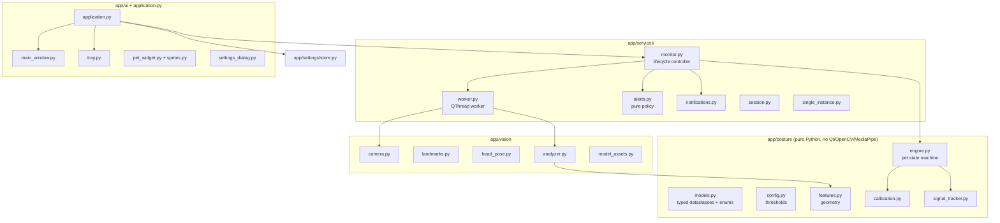
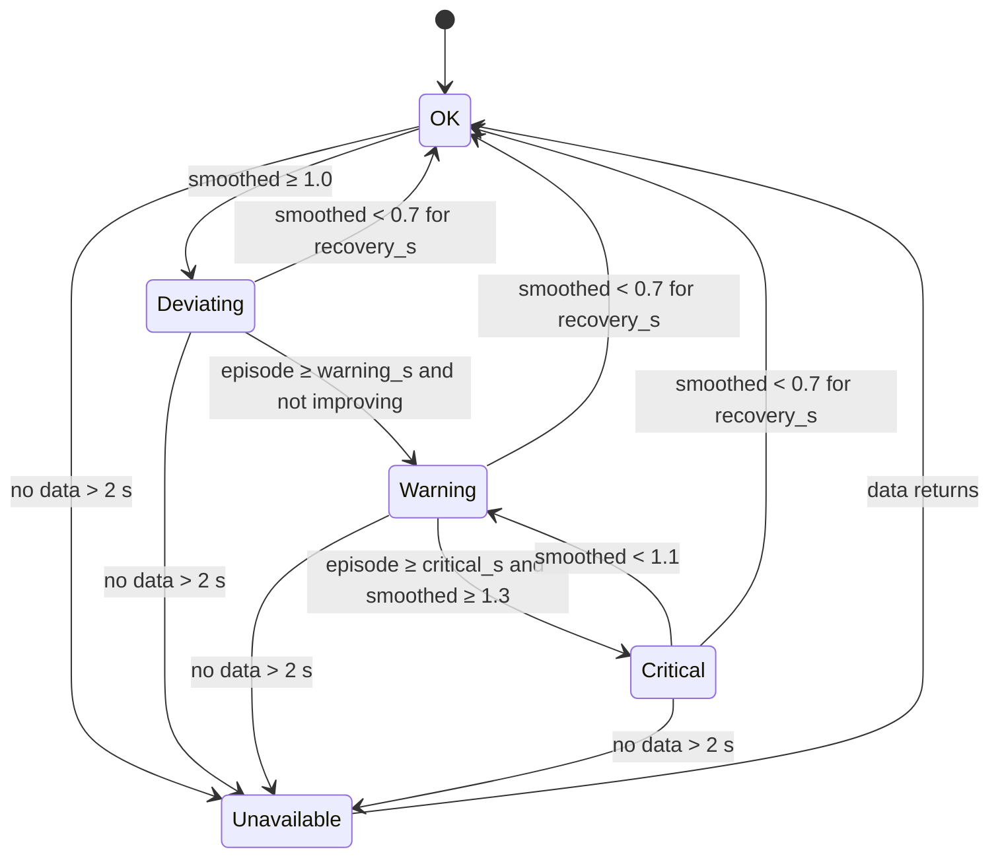

# Architecture

This document expands on README §5 and §8–12. The README stays the source of truth for
requirements and commands.

## Layers



Dependencies only point downwards: `posture` imports nothing from the other packages, and
`ui` never touches OpenCV or MediaPipe directly.

## Threads

| Thread | Owns | Talks to others via |
|---|---|---|
| Main (Qt GUI) | Window, tray, `MonitorController`, `PostureEngine`, `AlertPolicy`, settings | Qt signals |
| `PixelPostureVision` (`QThread`) | `CameraSource`, `FrameAnalyzer` (both MediaPipe models) | Emits `Observation` (frozen dataclass) and a **copied** `QImage`; reads a `threading.Event` stop flag and two bool flags |
| `CameraProbe` (short-lived) | Only when the user clicks **Detect** | Emits a list of indices |

Why the posture engine runs on the main thread: it costs microseconds per frame, so keeping
it next to the UI and the alert policy avoids locks entirely. Notifications therefore never
block the vision worker, and the worker cannot report a stale state after it is stopped:
`MonitorController._stop_worker` disconnects its signals before stopping it.

### Single camera owner

`MonitorController` holds at most one `(QThread, MonitorWorker)` pair. `start()` while a
worker exists is a no-op, which the lifecycle tests check. Pause, Stop, errors and Quit all go
through `_stop_worker`, which sets the stop event, waits up to 5 s for the thread, and only
then deletes it. The worker releases the camera and closes the models in a `finally` block.

### Camera outages

When `read()` returns no frame, the worker emits an empty `Observation` ("Camera is not
delivering frames") at most every 0.25 s. The engine therefore reaches *Tracking
unavailable* after its 2 s grace instead of showing a stale state. After 3 s without frames,
the worker releases and reopens the device **once** and re-emits `camera_started`, so a
changed resolution triggers recalibration. A second outage without good frames in between,
or a failed reopen, ends the session with an error. `SignalTracker` also treats a silent gap
longer than the grace (no observations at all, e.g. during sleep) as missing data, so the time
asleep is never counted as a posture issue.

## Coordinate conventions

* **Body:** normalized MediaPipe coordinates are converted to *aspect-corrected* units where
  x and y are both fractions of the frame height (y down). Ratios are normalized by shoulder
  width, so they barely change with distance from the camera.
* **Head:** from the facial transformation matrix `M` (canonical face → camera, right-handed,
  y up, the face looks along +z), the forward vector is `R[:, 2]`, which gives
  `pitch_down = asin(-R[1][2])` and `yaw = atan2(R[0][2], R[2][2])`.

  The sign was verified two ways:

  1. Against `canonical_face_model.obj` (nose tip z = +7.5, forehead y = +8.3, chin y = −9.4).
  2. On live webcam frames against an independent estimate from face-landmark depths. With
     MediaPipe's z convention (smaller = closer), the forehead is closer than the chin when
     looking down. The two estimates agreed in sign and moved together, for example −10° /
     −13° and later +6° / +12° as the head moved.

## Severity and timers

```
component deviation (feature units)  ──÷ tolerance × sensitivity──▶  ratio
back severity  = max(hunching, sinking, leaning-in, side-lean ratios)
head severity  = max(0, pitch_down − baseline) / tolerance   (None if |Δyaw| > 35°)
```

`SignalTracker` (one per signal) applies a time-based EMA (τ = 1 s), then:



`next_pet_state()` in `engine.py` combines the two signal levels into the pet state with an
explicit priority: Calibrating › Unavailable (both signals) › Critical › Warning › Thriving.

## Notifications

`AlertPolicy` is pure and fully unit-tested. `AlertDispatcher` wraps the two side effects:

* `TrayNotificationBackend` → `QSystemTrayIcon.showMessage`, which uses `Shell_NotifyIcon` on
  Windows. Windows 10/11 show these as native toasts and honour Focus / Do Not Disturb. No
  AppUserModelID registration is needed, which suits an unpackaged Python app.
* `SystemSoundPlayer` → `winsound.MessageBeep`, which is asynchronous.

Every exception from either is caught, logged and reported in a `DeliveryReport`.
Monitoring continues regardless.

`winotify` and `windows-toasts` were considered and rejected: for reliable delivery and
correct attribution they need a registered AppUserModelID (a Start-menu shortcut), which an
unpackaged Python script does not have.

## Pixel art

`ui/sprites.py` defines Pip as character grids with a small palette. The same definitions are
rendered with nearest-neighbour scaling in Qt (`pet_widget.py`, tray and window icons) and
exported to SVG for the website (`scripts/export_sprites.py`), so the app and the site always
match. Animation is two frames at about 2 fps, off when reduced motion is on, and paused while
the window is hidden.

## Settings

`AppSettings` is a frozen dataclass. `from_json_dict` validates types, and `validated()`
clamps ranges, so a hand-edited or corrupt file can never put the engine into an invalid
state. Saves are atomic (`.tmp` followed by `os.replace`).
